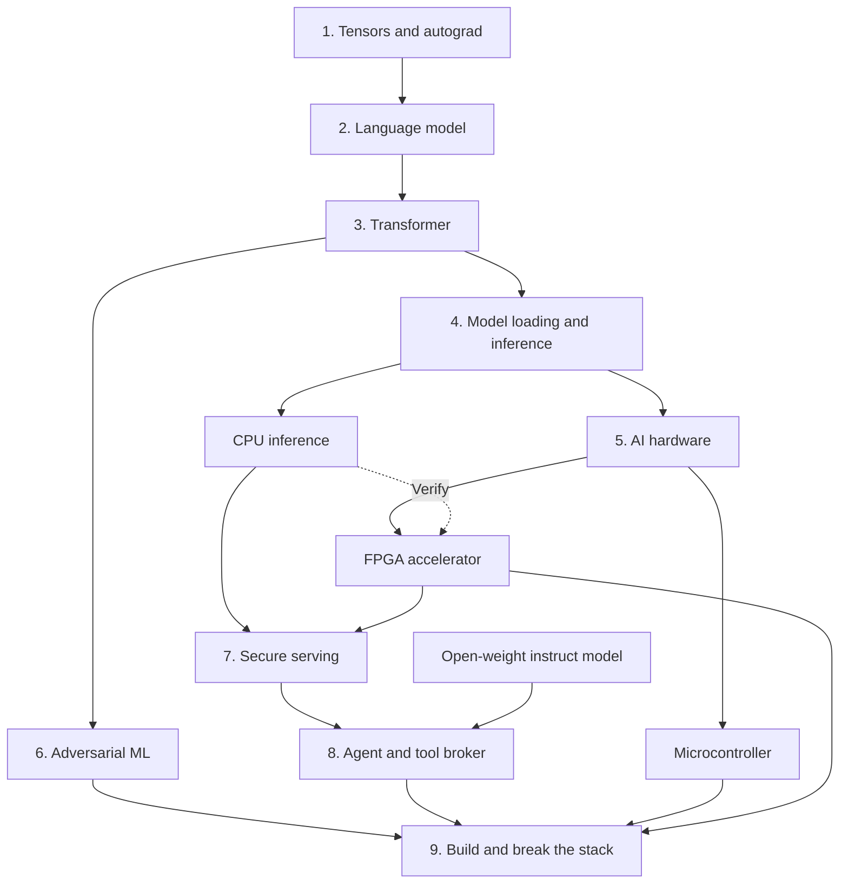

# From the Tensor

Most AI security roadmaps start with Python wrappers and prompt injection. That's backwards. You can't secure a thing you can't build. So build the stack, then break it.

About **62 weeks** at **8–12 hours/week**. Probably longer.

Line counts are budgets, not goals. C++ for the runtime, Rust for untrusted bytes and permissions, Python for training and attacks, C and SystemVerilog for hardware. Use something else if you have a good reason.

Hardware: a Raspberry Pi Pico and an ECP5 FPGA. Prefer an open toolchain. Prices vary; don't let the shopping become the project.

Inspired by [geohot/fromthetransistor](https://github.com/geohot/fromthetransistor). Independent project.

What are we building?

#### Section 1: Tensors: It's just numbers, right? -- 4 weeks

- **Building a tensor library (C++, ~1500 lines)** -- Shapes, strides, broadcasting, matmul. Hostile dimensions can allocate too much memory. Or too little. Check multiplication before allocating.
- **Building autograd (C++, ~1000 lines)** -- Reverse-mode differentiation, ReLU, softmax, cross-entropy. Broadcasting forward means summing gradients backward. Derive it before coding it.
- **Training a classifier (C++, ~300 lines)** -- XOR, then MNIST. SGD and Adam. Keep the classifier; Section 6 will attack it.
- **Breaking the tensor library (C++ + Python, ~200 lines)** -- Bad shapes, nonsense strides, NaNs, weird broadcasting. Diff against PyTorch. Run ASan and UBSan.

Read [Mathematics for Machine Learning](https://mml-book.com), [Dive into Deep Learning](https://d2l.ai/), and [3Blue1Brown](https://www.3blue1brown.com/?topic=neural-networks). Chain rule, Jacobians, probability, floating point.

Gradients don't match numerical differentiation? You have a bug. Bad shapes crash the process? Another bug.

#### Section 2: Learning: Guess the next byte -- 5 weeks

- **Building a tokenizer (Python, ~300 lines)** -- Bytes first. BPE later. A tokenizer isn't magic.
- **Building an n-gram model (Python, ~200 lines)** -- Count, divide, sample. No GPU. Everything else should beat this baseline.
- **Building a tiny language model (PyTorch, ~500 lines)** -- Embeddings, MLP, loss, optimizer. Train on a small corpus. Try porting it to your autograd engine if you want.
- **Planting canaries (Python, ~200 lines)** -- Put fake secrets in your own training set. Vary repetition, measure extraction against a clean run. Memorization, not poisoning.

Read [Zero to Hero](https://karpathy.ai/zero-to-hero.html), [CS231n](https://cs231n.stanford.edu/), [CS224N](https://web.stanford.edu/class/cs224n/), and [The Secret Sharer](https://arxiv.org/abs/1802.08232). Likelihood, entropy, perplexity, overfitting.

If the neural model can't beat an n-gram, what did the extra compute buy you?

#### Section 3: Transformers: So that's what attention does -- 7 weeks

- **Implementing attention (PyTorch, ~300 lines)** -- Q, K, V, masking, softmax, heads. Do the matmul. Print the shapes.
- **Building a decoder-only transformer (PyTorch, ~800 lines)** -- Embeddings, residuals, normalization, MLP, positions. Don't hide it behind a one-line Transformer class.
- **Training a little GPT (PyTorch, ~400 lines)** -- Train, checkpoint, sample. Diff intermediate tensors against an independent implementation. Count attention operations and bytes moved. Aim for ~100k parameters; it needs to fit on a microcontroller.
- **Abusing the inputs (PyTorch, ~200 lines)** -- Invalid token IDs, excessive contexts, precision changes, unstable softmax. Math failures or software bugs?

Read [Attention Is All You Need](https://arxiv.org/abs/1706.03762), [Let's build GPT](https://www.youtube.com/watch?v=kCc8FmEb1nY), [Stanford CS336](https://cs336.stanford.edu/), and [The Illustrated Transformer](https://jalammar.github.io/illustrated-transformer/).

Can't explain every tensor in the forward pass? Make the model smaller.

#### Section 4: Inference: Why are we trusting model files? -- 8 weeks

- **Dissecting a malicious pickle (Python, ~150 lines)** -- Pickles can execute code. Make a controlled example, inspect it with [fickling](https://github.com/trailofbits/fickling) and [picklescan](https://github.com/mmaitre314/picklescan). Write a detector, then find what it misses.
- **Building a model file parser (Rust, ~1000 lines)** -- Start with a tiny format, then a subset of [Safetensors](https://github.com/safetensors/safetensors). Validate lengths, offsets, shapes, overlaps, allocation limits. The file is allowed to lie. Enable release overflow checks. GGUF is optional; [real parsers have had real overflow bugs](https://github.com/ggml-org/llama.cpp/security/advisories/GHSA-vgg9-87g3-85w8).
- **Loading weights (Python + Rust, ~500 lines)** -- Export tensors as data, including INT8. Pass validated buffers to C++ over a small C ABI. Don't execute model files.
- **Building an inference loop (C++, ~1000 lines)** -- Forward pass, sampling, KV cache. Diff logits against PyTorch before blaming the model.
- **Building an INT8 CPU baseline (C++, ~300 lines)** -- INT8 matmul, int32 accumulation, per-channel scales, fixed-point requantization. Keep normalization and softmax in float. Define rounding and saturation. The FPGA must match this code bit for bit.
- **Fuzzing the parser (Rust, ~300 lines)** -- Truncation, oversized tensors, overlap, garbage. Run cargo-fuzz. Panics count as crashes.

Read [llama.cpp](https://github.com/ggml-org/llama.cpp), [ggml](https://github.com/ggml-org/ggml), [Safetensors](https://github.com/safetensors/safetensors), [Candle](https://github.com/huggingface/candle), and [Jacob et al.](https://arxiv.org/abs/1712.05877).

Checkpoint in, tokens out. Garbage in, error out.

#### Section 5: Hardware: Accelerators aren't magic -- 12 weeks

Don't buy a board until the INT8 CPU baseline works. Debugging two implementations at once isn't fun.

- **Running inference on a microcontroller (bare-metal C, ~300 lines)** -- Export the tiny GPT to a Raspberry Pi Pico using the [Pico SDK](https://github.com/raspberrypi/pico-sdk). Weights in flash, KV cache in RAM. Check memory first. Debug over UART.
- **Building a MAC unit (SystemVerilog, ~150 lines)** -- INT8 multiply, int32 accumulate, requantize, saturate. Simulate with [cocotb](https://www.cocotb.org/); compare against the CPU baseline.
- **Building a systolic array (SystemVerilog, ~800 lines)** -- Start at 8×8. Local reuse, buffers, real timing. Arithmetic is cheap; moving data isn't.
- **Building an accelerator interface (C + SystemVerilog, ~600 lines)** -- Control registers, streaming, DMA, driver. Run a real model layer on an ECP5 board. Benchmark against the CPU. A speedup without a measurement is a guess.
- **Making a measurement board (KiCad, optional)** -- Power sense, reset, debug header. Only if the experiment needs it.
- **Breaking your accelerator (C + Python, ~400 lines)** -- Bad commands, invalid DMA addresses, mid-inference resets, stale buffers. Turn bugs into tests. Your hardware only.

Suggested setup: [ULX3S](https://github.com/emard/ulx3s) 85F or suitable ECP5 board, [Yosys](https://github.com/YosysHQ/yosys), [nextpnr](https://github.com/YosysHQ/nextpnr), [LiteX](https://github.com/enjoy-digital/litex), VexRiscv host, Verilator SoC simulation. Zynq is an option with a different toolchain tradeoff. Check FPGA multiplier and RAM resources before buying.

Read [the TPU paper](https://arxiv.org/abs/1704.04760), [Sze et al.](https://arxiv.org/abs/1703.09039), and [Gemmini](https://github.com/ucb-bar/gemmini). Look at [TFLite Micro](https://github.com/tensorflow/tflite-micro). MACs, fixed point, SRAM, DMA, bandwidth.

The FPGA must run a real layer and match the CPU reference. A bigger array just produces wrong answers faster if it doesn't.

#### Section 6: Adversarial ML: Your accuracy number is lying -- 6 weeks

- **Writing FGSM and PGD (PyTorch, ~400 lines)** -- Attack the Section 1 MNIST model. Threat model and perturbation budget first. For text, try [HotFlip](https://arxiv.org/abs/1712.06751) or [GCG](https://arxiv.org/abs/2307.15043); optional.
- **Building an experiment runner (Python, ~400 lines)** -- Seeds, splits, clean and robust accuracy, confidence intervals. Comparable experiments or meaningless numbers.
- **Attacking the quantized path (Python, ~200 lines)** -- Generate attacks on FP32, replay on INT8 CPU and FPGA. Then adapt the attack to quantization. Gradient masking isn't robustness.
- **Trying adversarial training (PyTorch, ~300 lines)** -- Train against the attack. Then use a stronger one. See what survives.
- **Membership inference (PyTorch, ~200 lines)** -- Did a sample appear in training? Reuse the Section 2 canaries.
- **Cross-checking attacks (Python, ~150 lines)** -- [AutoAttack](https://github.com/fra31/auto-attack), [ART](https://github.com/Trusted-AI/adversarial-robustness-toolbox), alternate precisions, adaptive tests.

Read [Goodfellow](https://arxiv.org/abs/1412.6572), [Madry](https://arxiv.org/abs/1706.06083), [Athalye](https://arxiv.org/abs/1802.00420), [Carlini](https://arxiv.org/abs/1902.06705), and the [NIST taxonomy](https://csrc.nist.gov/pubs/ai/100/2/e2025/final).

An accuracy number without a threat model is marketing.

#### Section 7: Serving: Congratulations, it's on the internet -- 6 weeks

- **Building an inference server (C++, ~1200 lines)** -- Concurrent requests, bounded queues, cancellation, timeouts, memory quotas. Same runtime language, no hot-path FFI.
- **Building a KV-cache manager (C++, ~700 lines)** -- Allocate, page, reuse, evict. What happens when a request dies mid-decode?
- **Instrumenting a real runtime (C++, variable)** -- Measure batching, allocation and latency in [llama.cpp](https://github.com/ggml-org/llama.cpp). Compare with [vLLM](https://github.com/vllm-project/vllm). Connect the FPGA if it works.
- **Breaking isolation (Python, ~300 lines)** -- Synthetic tenants, cancellation races, shared-prefix timing, cache reuse, device reset, DMA-buffer tests. A timing difference alone isn't a leak.

Read [PagedAttention](https://arxiv.org/abs/2309.06180) and [Auditing Prompt Caching](https://arxiv.org/abs/2502.07776). Caches, concurrency, side channels, accelerator state.

No unbounded queues. No cross-tenant state. Test both.

#### Section 8: Agents: Please don't give the chatbot root -- 6 weeks

Your 100k-parameter GPT barely spells. Run a small open-weight instruct model through llama.cpp. The security boundary shouldn't care which model is asking.

- **Building a tool broker (Rust, ~1000 lines)** -- Typed requests, identities, capabilities, deny by default. Only trusted policy code creates authority. The model asks; the broker decides.
- **Building a fake company (Python, ~700 lines)** -- Documents, tickets, email, tenants, simple HTTP API. Mock data. Real permission boundaries.
- **Connecting an LLM (Rust, ~400 lines)** -- Parse proposed tool calls and authorize them independently. A document saying `system` doesn't make it a system message.
- **Attacking your own agent (Python, ~300 lines)** -- Inject instructions into retrieved documents and tool outputs. Attempt cross-tenant actions and memory contamination. Try [AgentDojo](https://github.com/ethz-spylab/agentdojo). Measure unauthorized actions, not weird-looking answers.

Read [Greshake](https://arxiv.org/abs/2302.12173), [CaMeL](https://arxiv.org/abs/2503.18813), [OWASP LLM Top 10](https://genai.owasp.org/llm-top-10/), [MITRE ATLAS](https://atlas.mitre.org/), [AI Village](https://aivillage.org/), and [Awesome AI Security](https://github.com/ottosulin/awesome-ai-security).

If a document can grant itself permission to send email, your security boundary is in the wrong place.

#### Section 9: Put it together: Now try to break the whole thing -- 8 weeks

- **Wiring up the stack (everything above)** -- Train, export, quantize, load, execute a layer on the FPGA, serve. Your tiny model exercises the full path. An open-weight instruct model drives the agent through the same server and broker.
- **Building an attack harness (Python, ~800 lines)** -- Bad model files, malicious pickles, adversarial inputs, overloaded serving, malformed hardware commands, resets, stale buffers, poisoned tool outputs. One stack, many ways to break it.
- **Hardening the mess (~500 lines)** -- Fix limits, lifetimes, memory, authorization, error handling. Regression test every actual bug.
- **Making it runnable** -- One command to build, one to test, one to attack. Simulate the SoC with Verilator in CI; test real FPGA separately. Save fixtures, logs, benchmarks.

Compare with [llama.cpp](https://github.com/ggml-org/llama.cpp) where useful.

Crashes, state leaks, unauthorized actions? Fix them. Run it again.

## Notes

Build in order. Each project uses something from the last. Cut features, not tests.

Every bug gets a regression test. Every speedup gets a benchmark.

Use higher-level tools until they hide what you're trying to learn. Then go lower.

Break what you own. Ship code, not screenshots.
